

## 🙋‍♀️ About Me &nbsp;

- 🎓 경영빅데이터학과 휴학 · iM뱅크 DiGital Banker Academy 9기 수강 중
- 💛 즐겁게 일하는 것을 좋아하고, 맡은 일에 애정을 갖고 성실하게 임합니다
- 🌱 부족한 점을 스스로 찾아 채워 가며 꾸준히 성장하려고 합니다

 

## 🛠 Tech Stack

| 분야 | 기술 |
|:---:|---|
| **Data&nbsp;Analysis** |                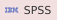 |
| **AI/&#8288;ML&nbsp;Engineering** |             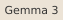 |
| **Frontend** |     |
| **Backend/&#8288;Server** |  |
| **Collaboration** |   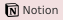  |

 

## 📂 Projects

### 📈 Data Analysis

<table>
<tr><td width="1000">

<b>💰 기업 고객 상담 후보 도구</b> 2026.09–10 · 5인 팀 · 팀장 · iM뱅크 교육

수출 증감률이 10%p 떨어지면 6개월 뒤 요구불예금이 비교 기업보다 **3.6%** 줄어드는 것을 확인하고, 상담 후보 제안 도구와 현황판으로 만들었습니다.

**내 역할** · 팀장으로 다섯 명의 분석을 하나의 결론으로 묶고, 저축성예금 분석과 효과 검증 실험 설계를 맡았습니다.

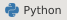 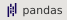  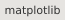 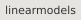 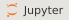    

자세히 보기

 

**지역 수출 경기 신호로 기업 고객 상담 후보를 고르는 도구**

대구·경북 법인 11,036곳의 36개월 계좌 데이터로, 수출 경기가 꺾일 때 어떤 계좌가 몇 개월 뒤 얼마나 변하는지 국소투영 패널 회귀로 분석했습니다. 수출 증감률 10%p 하락 시 6개월 뒤 요구불예금이 비교 기업보다 **3.6%** 줄어드는 것을 확인했고, 이를 바탕으로 상담 후보 제안 도구와 현황판을 만들었습니다.

**내 역할**
- **팀장**: 팀 운영·일정 관리, 다섯 명의 분석 결과를 같은 기준으로 묶어 하나의 결론으로 정리
- **저축성예금(거치식·적립식) 분석**: 처음 유의해 보인 +8.5%가 다중검정 보정과 잔액 0 관측 점검 뒤 약한 단서임을 확인하고 근거 수준을 구분해 정리
- **파일럿 설계서 작성**: 상담 후보 도구의 효과를 검증할 무작위 배정 실험 설계 (주지표, 층화 배정, 오염 방지, 최소검출효과)

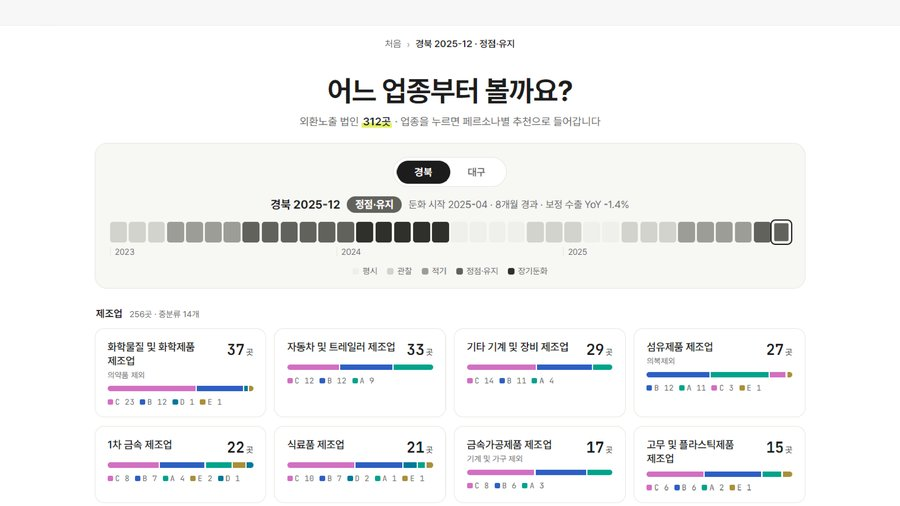

</td></tr>
</table>

<table>
<tr><td width="1000">

<b>🌡 대구 이중 기후위험 지도</b> 2026.10–11 · 개인 · 대구 공공데이터 분석

대구 133개 행정동에서 폭염과 오존이 3년 연속 겹친 동네 **16곳**을 찾아 우선 녹지 확충지를 제안했습니다.

**내 역할** · 개인 프로젝트로 데이터 수집부터 분석, 웹지도 제작까지 모두 했습니다.

    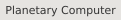    

자세히 보기

 

**대구 이중 기후위험 지도: 뜨거운 곳과 오존 높은 곳은 다르다**

Landsat 위성 지표온도, 에어코리아 대기질, 기상청 자료로 대구 133개 행정동에서 폭염과 오존이 3년 연속 겹친 동네 16곳을 찾고, 가로수 그늘과 무더위쉼터 공백을 더해 우선 녹지 확충지를 제안하는 스크롤형 웹지도를 만들었습니다.

**내 역할**
- 개인 프로젝트로 **데이터 수집·분석·시각화·웹지도 제작 전 과정** 수행

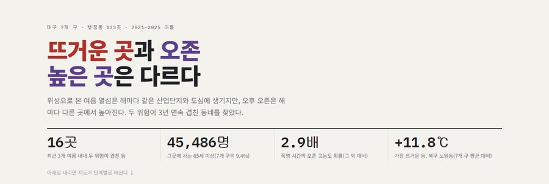
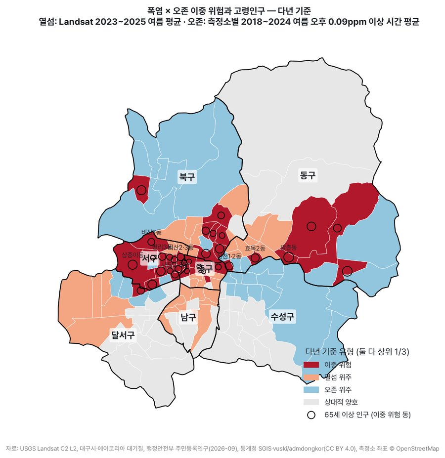 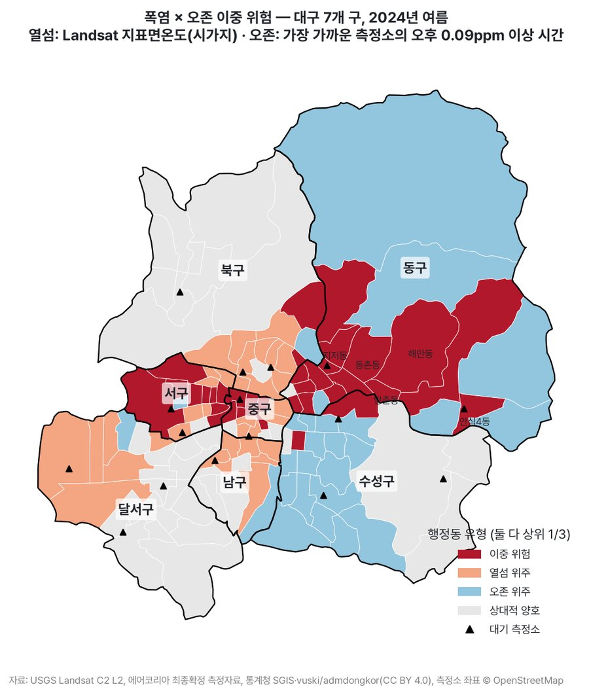

</td></tr>
</table>

<table>
<tr><td width="1000">

<b>🏪 자리이력서: 반복 폐업 분석</b> 2026.11 · 대구 공공데이터 분석 · 서비스 아이디어

음식점·카페 인허가 **129,054건**으로, 폐업이 반복된 자리에 새로 연 가게가 더 빨리 문을 닫는지 검증했습니다.

**내 역할** · 인허가 데이터 정제와 반복 폐업·골목 경보 분석, 서비스 아이디어 제안서 작성을 맡았습니다.

    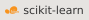   

자세히 보기

 

**자리이력서: 같은 자리에서 반복되는 폐업 분석**

대구 음식점·카페 인허가 129,054건으로 '폐업이 반복된 자리'에 새로 연 가게가 더 빨리 문을 닫는지 검증하고, 점포 자리마다 개업·폐업 이력과 주변 업종을 보여 주는 창업 지원 AI 서비스 아이디어로 정리했습니다.

**내 역할**
- 공공 인허가 데이터 정제와 **반복 폐업·골목 경보 분석**, 서비스 아이디어 제안서 작성

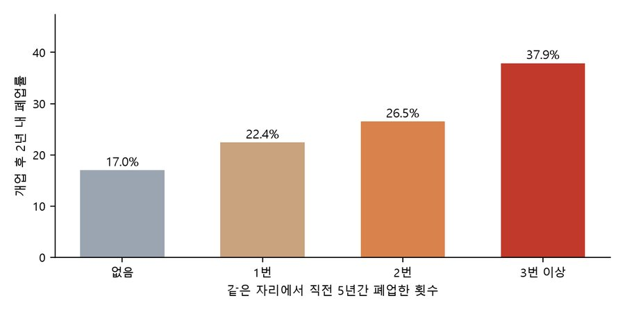 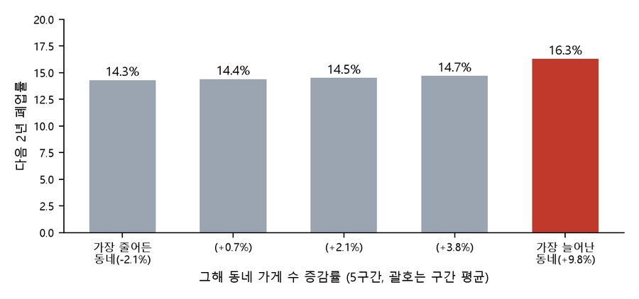

</td></tr>
</table>

<table>
<tr><td width="1000">

<b>🚇 대구 지하철 출퇴근 분석</b> 2025.03–12 · 5인 팀 · 팀장 · 알테어 동아리 지원 프로그램 4기

역별 승하차 데이터(2019–2024)로 역을 **베드타운·오피스타운·혼합형**으로 나누고 관광 대시보드로 넓혔습니다.

**내 역할** · 팀장으로 팀을 운영하고, 노코드 분석 도구(Altair AI Studio)로 데이터 분석을 주로 맡았습니다.

   

자세히 보기

 

**대구 지하철 출퇴근 패턴 분석과 '대구로 온나' 관광 대시보드**

대구 도시철도 역별·시간대별 승하차 데이터(2019–2024)로 출근 승차·퇴근 하차 비율을 만들고 X-Means 군집으로 역을 베드타운·오피스타운·혼합형으로 나눴습니다. 코로나 시기와 이후의 출퇴근 패턴 변화도 비교했습니다. 이 분석을 넓혀, 역별 혼잡도와 주변 관광지·리뷰를 한 화면에서 보는 Panopticon 대시보드 '대구로 온나'를 만들었습니다.

상반기에는 재활용품 오염도 예측(Random Forest, 정확도 73.57%)을 진행했지만, 오염 정도를 수치로 담은 데이터가 없다는 한계를 확인하고 주제를 바꿨습니다.

**내 역할**
- **팀장**: 팀원 관리, 지원금 관리, 월별 활동보고서 작성·포스팅
- **데이터 분석 (주 담당)**: 노코드 분석 도구 Altair AI Studio로 전처리·모델링 (라벨 없는 재활용품 데이터에 불량 라벨 직접 설계, 지하철 승하차 분석)
- 대시보드 제작은 팀원 모두 함께 참여

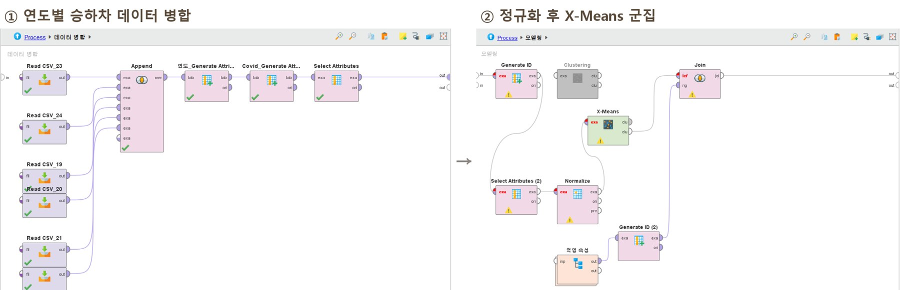

AI Studio 작업 화면 (팀 작업)

**배운 점**
- 전처리, 모델링, 평가 단계를 블록으로 배치하고 연결하며 분석 흐름을 단계별로 이해했습니다.
- 처음 다뤄 본 Panopticon으로 팀 대시보드를 끝까지 완성했습니다.

</td></tr>
</table>

 

### 🤖 AI/ML Engineering

<table>
<tr><td width="1000">

<b>🎮 Steam 게임 반응 예측</b> 2026.10–11 · 4인 팀 · iM뱅크 교육

출시 전 정보 51개로 1년 리뷰 수의 80% 범위를 예측해 시험 데이터에서 **79.3%** 적중했습니다.

**내 역할** · 데이터 수집 기준을 다시 설계하고, 출시 전 반응 예측 모델과 웹 프로토타입을 만들었습니다.

   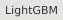 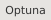  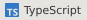     

자세히 보기

 

**Steam 게임 출시 전·후 반응 예측과 의사결정 지원 웹**

게임 개발사와 운영사가 기획 단계와 출시 직후에 "이 게임이 1년 동안 어느 정도 반응을 얻을지" 가늠해 볼 수 있도록 예측 모델과 React 웹 프로토타입을 만들었습니다. Kaggle 게임 정보와 Steam 공식 리뷰 API로 모은 9,492개 게임을 분석했습니다.

**내 역할**
- **데이터 수집·정제 설계**: 1차 수집 데이터(7,217개)에 결과 정보가 섞이는 문제를 찾아 수집 기준을 다시 설계(28,787개)
- **출시 전 반응 예측**: 장르·가격·출시 월·팀 이력·홍보 등 출시 전 정보 51개로 1년 리뷰 수의 80% 범위 예측 → 시험 데이터 적중률 **79.3%**
- **웹 프로토타입 구현·시연**: 화면 계산값이 파이썬 모델 값과 같은지까지 확인
- **발표 자료 제작**: 모든 수치를 원자료와 대조해 검수

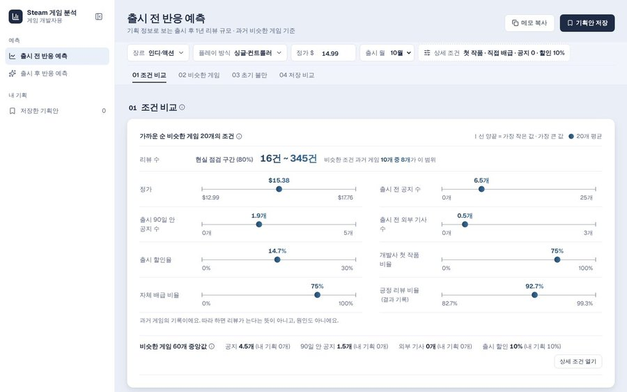 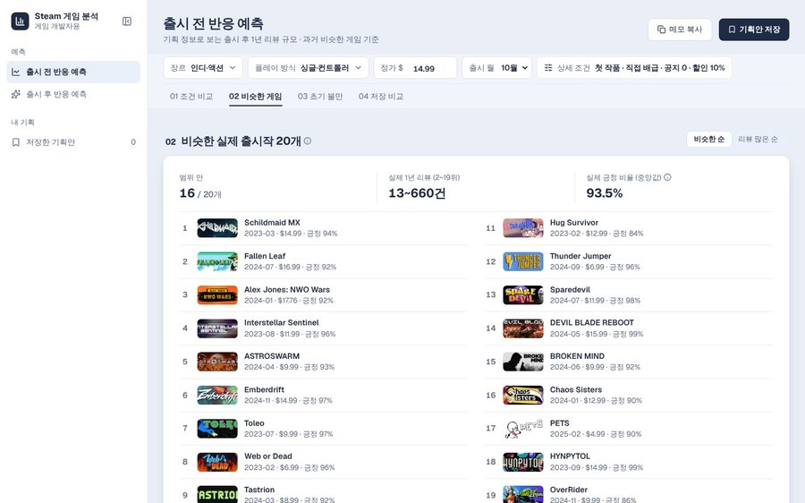

</td></tr>
</table>

<table>
<tr><td width="1000">

<b>📨 민원 상담 핵심어 추출 비교</b> 2025-2 과제 → 2026 재설계 · 개인

상담 100건의 정답을 직접 만들어 비교했고, 핵심어 포착률은 LLM이 **0.616**으로 단어 빈도(0.523)보다 높았지만 주제 묶기에서는 더 낫다는 근거를 얻지 못했습니다.

**내 역할** · 개인 프로젝트로 정제부터 정답 작성, 평가 설계와 채점까지 모두 했습니다.

      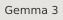   

자세히 보기

 

**공공 민원 상담 기록: 단순 기준선·LDA·로컬 LLM 비교**

국립아시아문화전당 민원 상담 기록에서 핵심 문의를 찾는 방법을 비교했습니다.

2025년 과제에서는 LDA 토픽 모델링과 오픈소스 LLM(Gemma 3) 키워드 추출을 비교했습니다. 제출 뒤 다시 검토해 중복 가능성, 다른 비교 단위, 빠진 기준선 같은 허점을 스스로 찾았고, 단계마다 고쳐 2026년에 재설계했습니다.

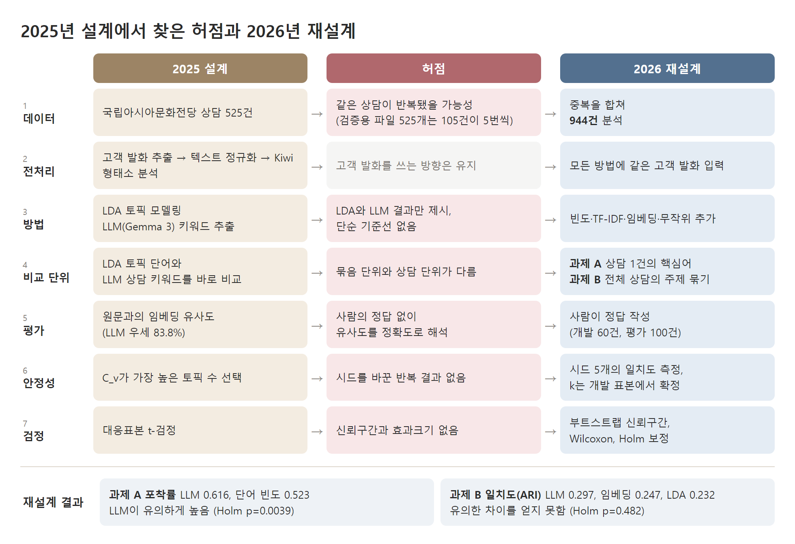

**재설계 결과**
- **상담 1건의 핵심어(평가 98건, 1회 채점):** 로컬 LLM(gemma3:4b) 포착률 0.616 [95% CI 0.561, 0.673]. 단어 빈도 0.523보다 0.094 높음(Holm p=0.0039)
- **전체 주제 묶기(평가 97건):** 사람 유형과의 ARI는 LLM 0.297, 임베딩 0.247, LDA 0.232. 차이가 유의하지 않아 LLM이 더 낫다는 근거를 얻지 못함(Holm p=0.482)
- **한계:** 라벨러 1명, 기관 1곳, 모델·프롬프트 1개씩

**내 역할**
- 개인 프로젝트로 **전처리·모델링·평가 설계** 전 과정, 재설계에서는 표본 추출·정답 작성·채점까지 진행. 공개한 LLM 결과는 본인 PC의 Ollama에서 실행

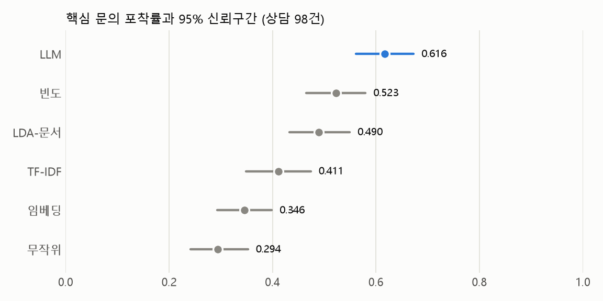

데이터: AI 허브(aihub.or.kr) "공공 민원 상담 LLM 사전학습 및 Instruction Tuning 데이터", 한국지능정보사회진흥원(NIA) 사업결과 활용. 원문과 재가공 데이터는 공개하지 않습니다.

</td></tr>
</table>

<table>
<tr><td width="1000">

<b>⚖️ 법률 질의응답 RAG 비교</b> 2025-2 · 3인 팀 · 교내 LLM 집중 연구 프로그램

판결문을 검색 문서로 쓴 RAG 시스템의 답변 품질을 비교했습니다.

**내 역할** · 세 시스템의 답변을 채점하는 평가 지표 실험을 맡았습니다.

  

데이터: AI 허브(aihub.or.kr) "지식재산권법 LLM 사전학습 및 Instruction Tuning 데이터". 데이터와 결과는 공개하지 않습니다.

</td></tr>
</table>

 

### 💡 Service Planning & Development

<table>
<tr><td width="1000">

<b>📝 비포블랭크</b> 2026 · 개인

AI 답을 보기 전에 **내 생각부터 적는** 질문 노트입니다.

**내 역할** · 개인 프로젝트로 기획부터 화면 설계, 개발, 배포까지 모두 했습니다.

 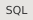   

자세히 보기

 

**비포블랭크 Before Blank**

AI 답을 보기 전에 내 생각부터 적는 질문 노트입니다. AI 답에서 곁가지는 메모함에 담고, 주제별 대화는 마인드맵으로 자동 정리해 AI에 끌려가지 않고 주도적으로 쓰도록 돕습니다. → [저장소 보기](https://github.com/dahye292/before-blank)

**내 역할**
- 개인 프로젝트로 **기획·화면 설계·개발(Flask + Claude API)·배포** 전 과정

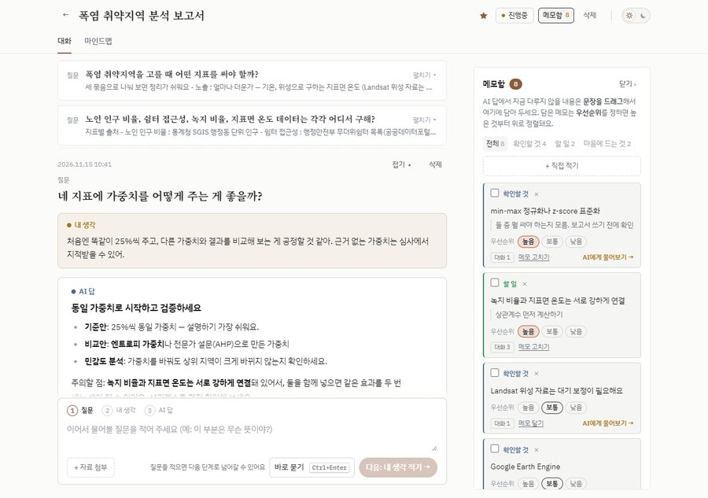 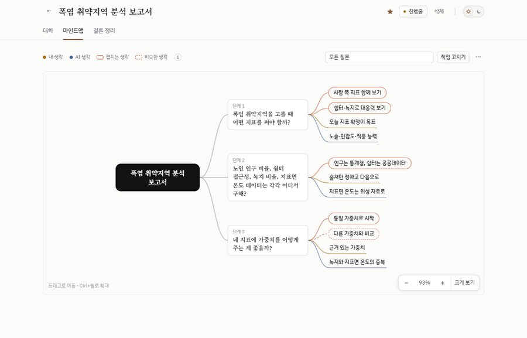

</td></tr>
</table>

<table>
<tr><td width="1000">

<b>🗺 인증 없이 가는 서울</b> 2026.11 · 팀 · 서울관광 프롬프톤 Track 2 · 진행 중

Reddit 글 **1,131건**으로 외국인 관광객이 인증·결제·예약에서 막히는 지점을 모아 서비스를 기획하고 있습니다.

**내 역할** · Reddit 한국 여행 글 1,131건으로 외국인의 불편을 분류하고, 대안 앱 목록을 정리했습니다.

   

자세히 보기

 

**인증 없이 가는 서울**

외국인 관광객이 한국 번호 인증·해외 카드 결제·전화 예약 같은 벽에 막히는 지점을 모아, 장소마다 '그냥 갈 수 있는지'를 알려 주고 서울관광재단 데이터의 빈틈을 보강하는 서비스를 기획하고 있습니다.

**내 역할**
- **외국인 불편 수집**: Reddit 한국 여행 글 1,131건을 모아 인증·결제·예약·소통 등 분야별로 분류
- **대안 앱 목록(Access KB)**: 불편마다 외국인이 쓸 수 있는 대안 서비스 정리

</td></tr>
</table>

 

### 📊 Undergraduate (2024)

**사용한 프로그램** &nbsp;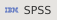    

| 프로젝트 | 도구 · 방법 |
|---|---|
| 범죄 발생 통계 분석 |   |
| 여가시간과 우울감 비교 |   |
| 사고유형별 교통사고 현황 파악 |   |
| 온라인 쇼핑 고객 이탈 예측 |   |
| 삼성SDI 주가 예측 |    |
| 남녀 취업률 상관분석 |   |
| RapidMiner 분석 |   |
| DB 모델링 |   |

 

## 🏅 Certificates & Education

| 구분 | 내용 | 시기 |
|---|---|---|
| 자격증 | **ADsP** 데이터분석 준전문가 (한국데이터산업진흥원) | 2026.06 |
| 수료 | **[Google AI 전문 과정](https://coursera.org/share/4f11ba9666875ff7208affc835b29fac)** (Coursera, 8개 강좌) | 2026.09 |
| 수료 | **알테어 동아리 지원 프로그램 4기** (한국알테어) | 2025.03 – 2025.12 |
| 수료 | **Machine Learning Professional** (Altair) 

🔍 수료증 보기
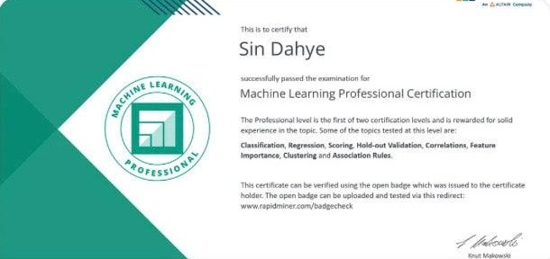
 | 2025.03 |
| 교육 | **iM DiGital Banker Academy 9기** (iM뱅크 · 6개월 장기 과정) | 2026.08 – 2027.02 |
| 준비 중 | **SQLD** | |

 

## 📈 GitHub Stats

<picture>
  <source media="(prefers-color-scheme: dark)" srcset="https://raw.githubusercontent.com/dahye292/dahye292/output/pacman-contribution-graph-dark.svg">
  
</picture>

  
  

